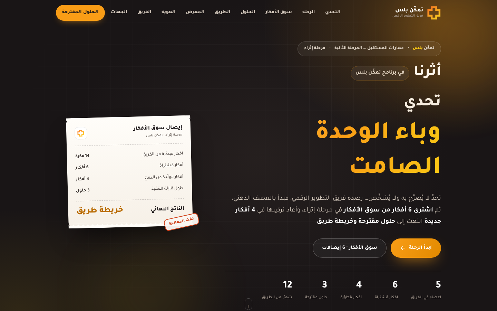
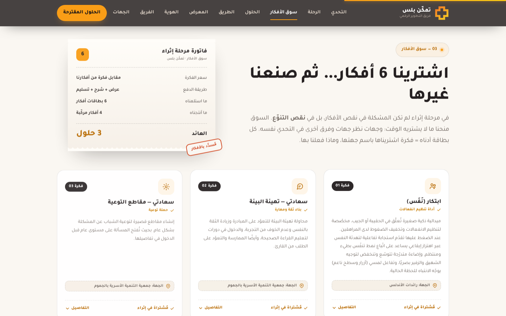
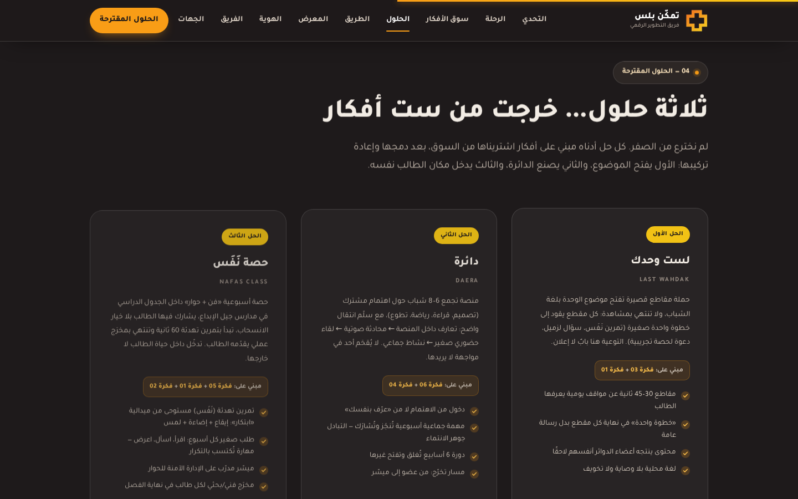

<div align="center">

# أثرنا
### في برنامج تمكّن بلس

**تحدي وباء الوحدة الصامت**

فريق التطوير الرقمي — جمعية رواد جيل الإبداع
تحت مظلة جمعية ريادة ومؤسسة سالم بن محفوظ الأهلية · برنامج مهارات المستقبل — المرحلة الثانية (تمكّن بلس) · مدارس جيل الإبداع



</div>

---

## عن الموقع

موقع صفحة واحدة (عربي RTL) يعرض أثر الفريق في البرنامج: التحدي → الأفكار المبدئية → شراء 6 أفكار من سوق الأفكار → الحلول المقترحة → خريطة الطريق.

- ملف واحد يعمل بدون إنترنت: `index.html` (الخطوط والصور والشعارات مضمّنة داخله).
- للعرض المباشر: افتح `index.html` في المتصفح، أو انشر المستودع على GitHub Pages (Settings → Pages → Branch: `main` / root).

<div align="center">
 
</div>

---

> جميع الأفكار في الموقع منقولة **حرفيًا كما وردت في ملف الفريق** (بطاقات سوق الأفكار)، مع اسم الجهة المصدر لكل فكرة.

---

## 1) الملفات

| الملف | الوصف |
|---|---|
| `index.html` | الموقع كاملًا (HTML + CSS + JS + الخطوط مضمّنة). يعمل بدون إنترنت ويمكن إرساله كملف واحد. |
| `assets/brand/logo-white.png` | الشعار الرسمي (أبيض + برتقالي) للخلفيات الفحمية — مستخرج من الشعار الرسمي بخلفية شفافة |
| `assets/brand/logo-dark.png` | الشعار الرسمي (فحمي + برتقالي) للخلفيات الفاتحة |
| `assets/brand/mark.png` | علامة الصليب فقط — للأيقونات والأفاتار وأيقونة المتصفح |
| `assets/brand/wordmark.png` | الوردمارك العربي وحده |
| `assets/brand/mark-square.png` | العلامة داخل مربع (للاستخدام كصورة ملف شخصي) |
| `assets/partners/*.png` | شعارات الجهات (مدمجة داخل الموقع وموجودة هنا كملفات مستقلة): مؤسسة سالم بن محفوظ الأهلية، جمعية ريادة، برنامج مهارات المستقبل، مدارس جيل الإبداع |
| `assets/partners/*.svg` | نسخ متجهة (SVG) لشعاري سالم بن محفوظ وجمعية ريادة |
| `assets/evidence/doc-1.jpg`, `doc-2.jpg` | صفحتا ملف الفريق «ما تعلّمناه من السوق» (مضمّنتان أيضًا داخل `index.html`) |
| `tools/frames.py` | استخراج صور من فيديوهات الفريق وربطها بالشريط تلقائيًا |
| `sources/` | مجلد وضع ملفات الفيديو الأصلية |
| `shots/` | صور معاينة للموقع (لقطات شاشة) |

للمعاينة: افتح `index.html` في أي متصفح، أو ارفعه على أي استضافة (Netlify / Vercel / GitHub Pages).

---

## 2) إضافة صور الفيديو الحقيقية (الشريط)

1. ضع مقاطع الفيديو في مجلد `sources/`.
2. نفّذ:

```bash
python3 tools/frames.py --per-video 2
```

سيقوم السكربت بـ:
- استخراج إطار (صورة) من منتصف كل مقطع تقريبًا وحفظه في `assets/` بصيغة JPG بعرض 1280 بكسل،
- تحديث شريط التمرير في `index.html` تلقائيًا (أول الشرائح تُملأ بالصور).

أو ضع الصور يدويًا في `assets/` ثم عدّل مصفوفة `SLIDES` داخل `index.html`:

```js
const SLIDES = [
  {tc:'00:00:41', tag:'جلسة 01', t:'انطلاق التحدي', d:'الوصف…', img:'assets/frame-01.jpg'},
  ...
];
```

> إذا كانت قيمة `img` فارغة `''` يظهر إطار بديل أنيق داخل الشريط (مكان الصورة) — أي أن الموقع لا يبدو مكسورًا قبل إضافة الصور.

---

## 3) تعديل المحتوى

كل المحتوى القابل للتغيير موجود في وسم `<script>` في نهاية `index.html`:

- `IDEAS` — **بطاقات الأفكار الست المشتراة**، وكل بطاقة فيها: `name` الاسم، `src` الجهة التي قدّمت الفكرة، `type` التصنيف، `desc` الوصف كما ورد في الملف، `take` لماذا استفدنا منها، `how` كيف طوّرناها.
  | # | الفكرة | الجهة المصدر | صارت في الموقع |
  |---|---|---|---|
  | 01 | ابتكار (نَفَس) | رائدات الأندلس | بطاقة نَفَس + الحل الثالث |
  | 02 | سعادتي — تهيئة البيئة | جمعية التنمية الأسرية بالجموم | مسار الثقة + الحل الثالث |
  | 03 | سعادتي — مقاطع التوعية | جمعية التنمية الأسرية بالجموم | حملة «لست وحدك» (الحل الأول) |
  | 04 | البداية من التطبيقات | أكاديمية أوتو بمكة (02) | سلّم الانتقال في «دائرة» |
  | 05 | حصة اجتماعية | أكاديمية أوتو بمكة (02) | «حصة نَفَس» (الحل الثالث) |
  | 06 | منصة المشاركة | نادي رواد المستقبل — الشوقية | منصة «دائرة» (الحل الثاني) |
- `FUSION` — الأفكار الأربع التي وُلدت من الدمج بين الأفكار المشتراة.
- `SLIDES` — شرائح شريط التمرير (توقيت، وسم، عنوان، وصف، مسار الصورة).
- `EVIDENCE` — شواهد ملف الفريق (صفحتا «ما تعلّمناه من السوق») المعروضة أسفل الشريط، تُفتح بالتكبير عند الضغط.

النصوص الثابتة (التحدي، المحطات الست، «ماذا تعلّمنا من السوق»، «كيف كيفناه»، الحلول الثلاثة، خريطة الطريق، الفريق) مكتوبة مباشرة داخل أقسام `<section>` ويمكن تحريرها كنص عادي.

## 4) الهوية البصرية

الهوية مأخوذة من شعار **تمكّن بلس** الرسمي:

| العنصر | القيمة |
|---|---|
| فحمي عميق (خلفية أساسية) | `#231F20` |
| برتقالي تمكّن | `#F99D16` |
| أصفر مشع (تدرّج الشعار) | `#FAC915` |
| بيج دافئ (تأكيد ناعم) | `#FFE7BF` |
| طوبي (تنبيه/ختم) | `#D1441D` |
| أبيض دافئ (خلفية فاتحة) | `#FAF7F2` |
| الخط | Tajawal (400 / 500 / 700 / 800) — مضمّن داخل الملف |

**قواعد الشعار**
- علامة الصليب دائمًا بالتدرّج البرتقالي ← الأصفر، ولا تُلوَّن بلون آخر ولا تُعاد رسمها.
- على الخلفيات الفحمية: `logo-white.png` — على الخلفيات الكريميّة: `logo-dark.png`.
- مساحة حماية حول الشعار لا تقل عن ارتفاع علامة الصليب، ولا يوضع على صورة مزدحمة أو خلفية برتقالية.
- حرف النون في الشعار مرسوم بضربة برتقالية؛ لا يُعاد كتابته بخط آخر في التطبيقات الرسمية.

## 5) حالة المحتوى والصور

- **المحتوى:** الأفكار الست والحلول وخريطة الطريق مبنية على ملف الفريق كما أُرسل (مصادر الأفكار مذكورة على كل بطاقة).
- **الشواهد:** بطاقتا «ما تعلّمناه من السوق» في قسم المعرض هما صور ملف الفريق نفسه، مضمّنتان داخل `index.html`.
- **الفيديو:** مجلد Google Drive ما زال **محميًا** وقت التنفيذ (يطلب تسجيل دخول)، لذلك إطارات الشريط الثمانية بدائل مصمّمة تحمل توقيتًا وعلامة مائية، وتُستبدل تلقائيًا بمجرد وصول الفيديوهات إلى `sources/`.

### قائمة استبدال سريعة
- [ ] صور/إطارات الفيديو الحقيقية (عبر `tools/frames.py`) — الطلب الوحيد المتبقي على الفريق
- [ ] مقتبسات الشواهد من المقابلات (إن رغبتم بإضافتها في قسم التحدي)
- [ ] **شعار جمعية رواد جيل الإبداع الرسمي** — القسم يعرضه حاليًا كـ«وردمارك» نصي؛ أرسل ملف PNG/SVG وسأستبدله في مكانه مباشرة
- [ ] تأكيد أن شعار «جمعية ريادة» المستخدم هو الشعار المعتمد لديكم (مصدره: الهوية المنشورة لجمعية ريادة لبناء وتطوير القدرات الشبابية)
- [ ] أدوار أعضاء الفريق إن أردتم تمييزها (تصميم / تطوير / محتوى / تنسيق)

---

فريق التطوير الرقمي — جمعية رواد جيل الإبداع
إسماعيل فطاني · نزار فلالي · يمان دعبول · عبدالكريم دبسون · مصعب المخلافي

تحت مظلة جمعية ريادة ومؤسسة سالم بن محفوظ الأهلية — برنامج مهارات المستقبل المرحلة الثانية (تمكن +) — مدارس جيل الإبداع.
